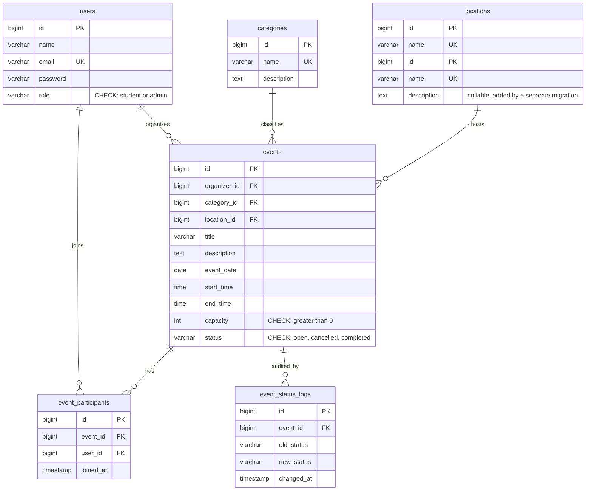

# CampusConnect ERD

**Notes**
- `event_participants` has UNIQUE(event_id, user_id), so nobody can join twice.
- `events` has CHECK(end_time > start_time).
- Deletes: events to users, categories, locations are RESTRICT. event_participants and event_status_logs are CASCADE.
- `event_status_logs` is filled by the trigger `trg_event_status_log`, not by Laravel.
- Laravel framework tables (cache, jobs, sessions, migrations, etc.) are left out.